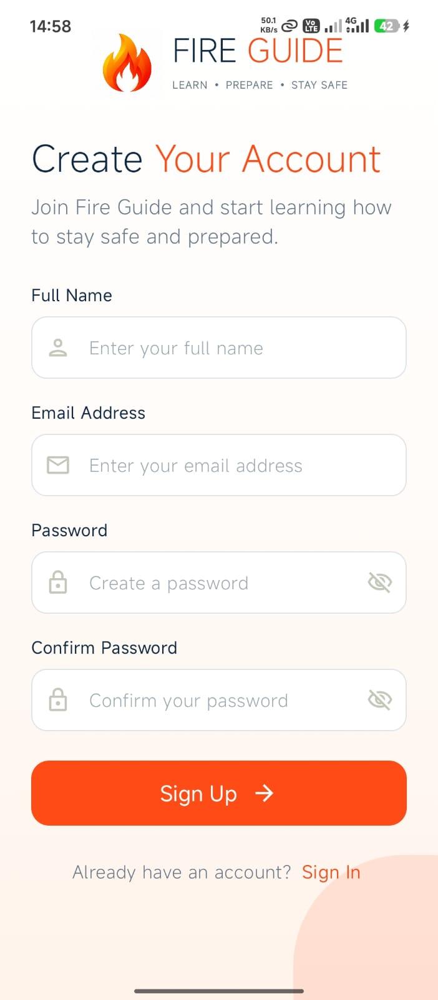
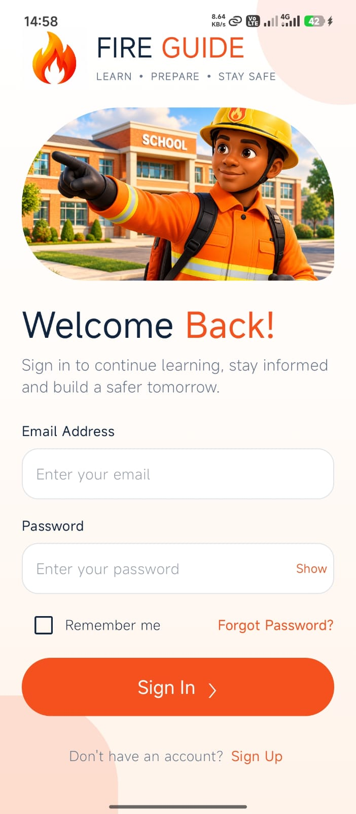
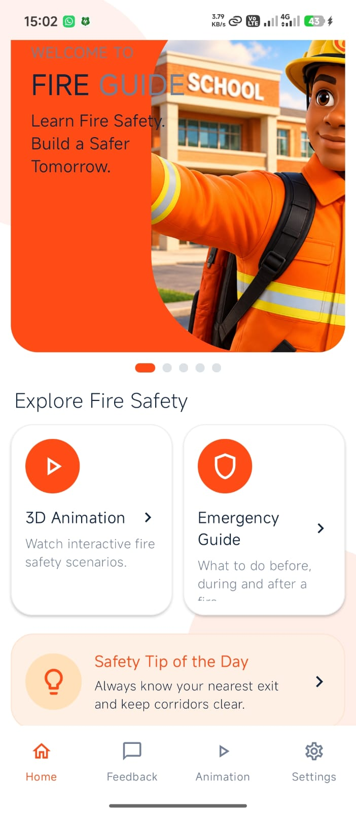
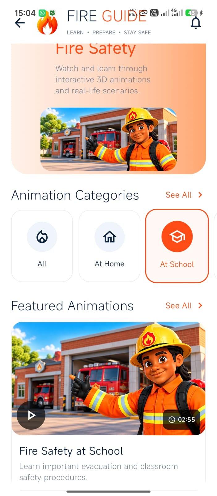
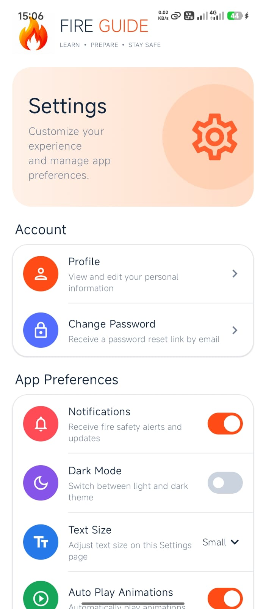
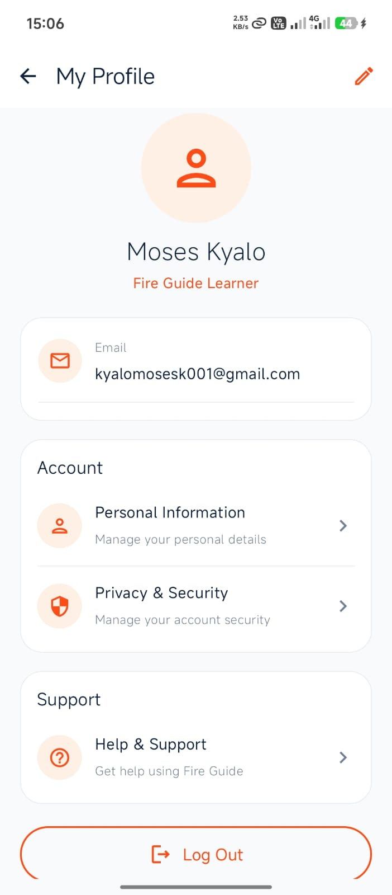
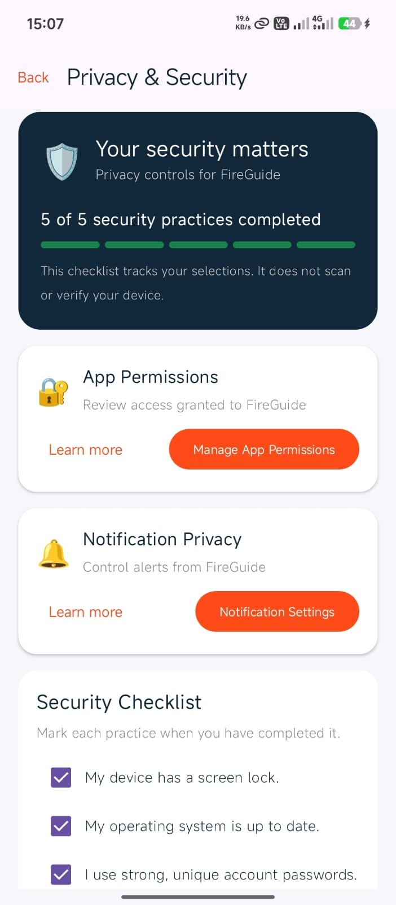
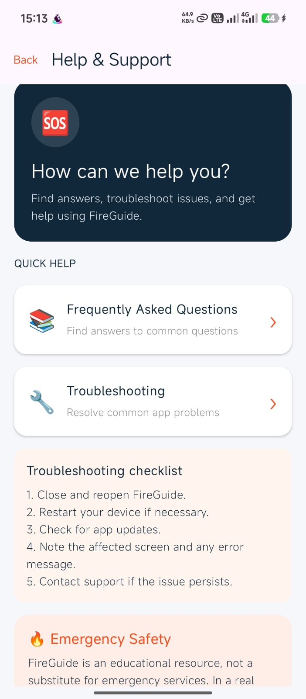
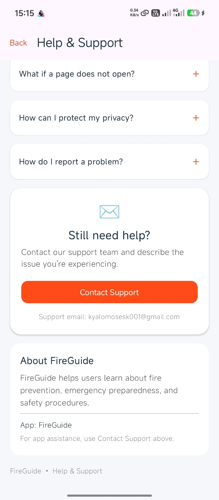

# FIREGUIDE
A Mobile Application for educating students on fire-safety and evacuation procedures using 3D animated videos.

# Technologies Used
- Kotlin
- Jetpack Compose
- Android Studio
- Android SDK
- Gradle
- Git & GitHub

# Features
The main features of Fire Guide are:
- User-friendly welcome screen and dashboard.
- Interactive fire-safety animations and videos.
- Emergency evacuation and fire-response guidance.
- Daily fire-safety tips.
- User feedback through an email application.
- Profile and settings navigation.
- Privacy and security information.
- Help and support.

# Screenshots
The following screenshots show the Fire Guide App intermittent user interfaces.
<table>
  <tr>
    <th>Sign Up</th>
    <th>Sign In</th>
    <th>Home Screen</th>
  </tr>
  <tr>
    <td align="center"></td>
    <td align="center"></td>
    <td align="center"></td>
  </tr>
  <tr>
    <th>Animation</th>
    <th>Settings</th>
    <th>Profile Screen</th>
  </tr>
  <tr>
    <td align="center"></td>
    <td align="center"></td>
    <td align="center"></td>
  </tr>
  <tr>
    <th>Privacy and Security</th>
    <th>Help and Support-1</th>
    <th>Help and Support-2</th>
  </tr>
  <tr>
    <td align="center"></td>
    <td align="center"></td>
    <td align="center"></td>
    <td></td>
    <td></td>
  </tr>
</table>

# Download the App
Download the APK from the latest GitHub release:

[**Download FireGuide APP v1.1.1**](https://github.com/Moses-11/FIREGUIDE/releases/tag/v1.1.1)

1. Open the release page on your Android phone.
2. Download `app-debug.apk`.
3. Open the downloaded file and follow Android's installation prompts.

*Note: This is a debug APK intended for testing.*

# How to Run the Project
1. Clone or download this repository.
2. Open the project in Android Studio.
3. Allow Gradle to sync.
4. Connect an Android phone or start an emulator.
5. Run the app from Android Studio.

# Developer
**Moses Kyalo**

IT Student | Kotlin | Android Development

## Repository

[View FireGuide on GitHub](https://github.com/Moses-11/FIREGUIDE)

